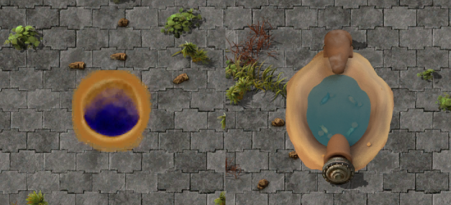

# Fish Pond V2 — accepted and integrated

The existing Clay Pit V4c-derived basin is retained. Four small fish swim along
an ellipse with tangent headings and editable tail strokes. Supported hollow
ceramic mouths meet the actual native north/south joint planes. Procedural clay
and fish surfaces are baked into packed albedo, roughness and normal images;
the GLB uses a portable transparent water material.

The owner reviewed the actual before/after capture and answered **“Accept and
integrate (Recommended)”** on 2026-11-15. The exact source and export hashes are
bound in [owner-disposition.json](owner-disposition.json).

[Animated Blender loop](fish-pond-v2-loop.png) ·
[All four connected native facings](native-four-connections.png) ·
[Reasoned visual review](visual-review.json)

Registered as `tanks-fish-pond-v2` in the [canonical FMPL library](https://github.com/mrcalzon02/Tech-Priests/blob/1276ab6a70189926deeb15240bd86df745f0b794/tools/fmpl/FMPL.json),
with an installed checkpoint and verified remote source/export hashes. See the
[publication receipt](publication-receipt.json).

## Verified delivery

- Editable Blender 5.0 source and actual reimported GLB: 8,412 triangles,
  30 meshes, no degenerate triangles, UVs on every mesh, three packed PBR maps.
- All 97 working poses match the evaluated source within 0.000000123 tiles.
  Pipe walls are closed manifolds with one connected component; no socket moves.
- One canonical fixed 45° camera; four idle and 64 true working RGBA renders.
  Six 64/128/256 atlases. Native idle sheets explicitly repeat the single idle
  render to match the working animation's required 16 cells.
- Factorio 2.1.24: 20 real ponds, all four facings, catch/55-second harvest,
  unfuelled stop, blocked output, stop/restart and save/reload passed. A test-only
  fluid recipe exercises both native ports without changing any real recipe.
- Twenty-four actual graphical captures include idle, working, a second working
  pose, connected pipes and the exact legacy prototype. The active production
  adapter then passed the same native test with **no proof-addon art override**.

Evidence: [production receipt](engine-receipt.json), [unaltered engine log](native.log),
[reload log](reload.log), [graphical capture hashes](capture-receipt.json),
[package verification](package-receipt.json), [delivery receipt](delivery-receipt.json).

The active 1.8.103 source contains the accepted graphics and native animation
registration. A byte-verified installable ZIP is built locally. The user's mod
directory and saves are untouched; this is not a Mod Portal release.

## Function and limits

The original 3×3 assembling-machine, 15 kW chemical burner, .60 crafting speed,
fishery recipes, collision, fluid positions/volumes/flows, pipe covers, smoke
and light remain. Current fishery recipes do not consume fluids. The authored
mouths replace the legacy connector pictures; native caps still close unused
ports. The renderer's derived Y unforeshortening matches Factorio's ground
projection; editable source and GLB retain unit-scale geometry.

The GLB carries the working loop. FMPL consumers hide the fish/eye visibility
group for idle, as recorded in the asset manifest. Factorio itself uses native
idle/working sprite state selection, with no new per-tick controller.

Failed pilot studies remain locally preserved. Pilot 02 exposed split export
clips and top-edge clipping; 03 corrected them and exposed overlapping reference
bore walls; 04 replaced those overlaps with continuous geometry. The final
source/export and captured frames are preserved in `candidates/v2-production01`.
