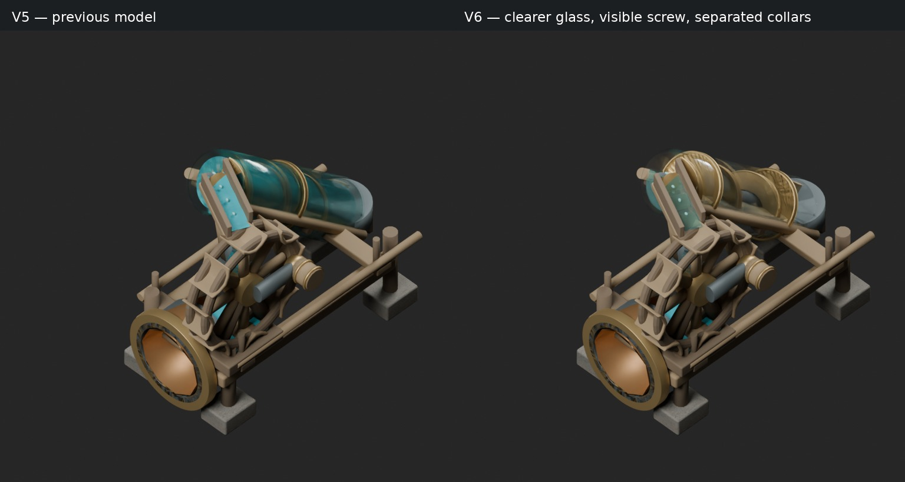
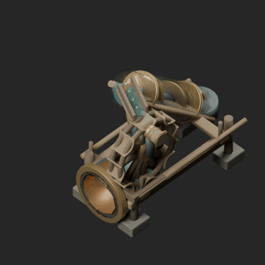
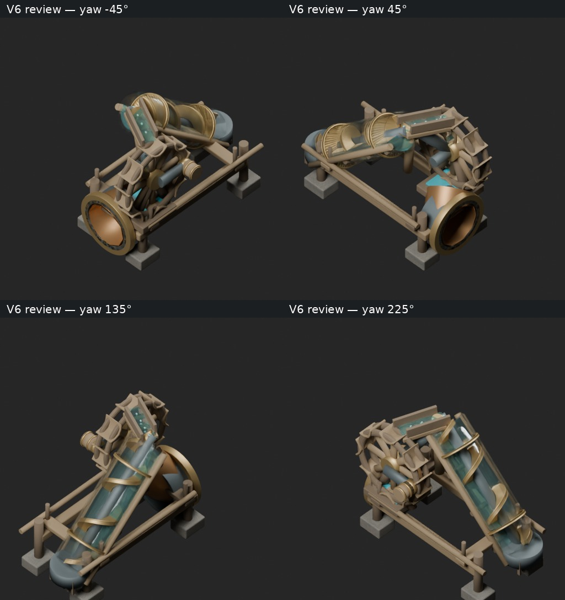

# Beach pump V6 — visual review checkpoint

Actual editable Blender refinement of the reconstructed V5 master, SHA256
`a6f7c938835b98e2a24e4bac513627daccc83e6cd9d4c600e81b20c81eb93db1`.
Rendered locally with Blender 5.0.1 / Cycles. The original 5.2 master is preserved
unchanged in generated-v5-review/source-parts. This V6 file independently reopens
in 5.0.1 with wheel, screw and water animation intact.





Changes: nearly colorless glass with restrained reflections; a continuous
half-filled water mesh with a traveling free surface; separated brass collars
(V5 accidentally placed both at the sleeve center); softened bronze flight edges;
falling water hidden at idle frame zero. The water uses authored mesh animation,
not a fluid dynamics simulation. The wheel/crank and screw retain their real rigs.

Validation: 21 new Cycles renders (one 768px hero, sixteen 448px motion frames,
four 512px review views), plus one matching V5 baseline render. Independent native
reopen verified movement, periodic endpoints, 45-degree orthographic camera,
separated collars, idle spill visibility and zero pipe-port vertex drift.
Reports: [review-checks.json](review-checks.json),
[independent-reopen.json](independent-reopen.json).

This remains a review candidate, not an approved or integrated game asset.
Wood still reads too uniformly smooth. Wheel/discharge geometry remains crowded;
the water film's landing and wheel/trough clearance need the next geometry pass.
The preview yaw angles are for inspecting the model; no production atlases were
captured. No Factorio prototype, gameplay, pipe connection, or rate was edited.

Reproduce using the checksum-verified V5 native file:

```sh
blender -b generated-v5-review/beach-pump-v5.blend --python v6/refine_native.py -- --out /absolute/review --animation
blender -b /absolute/review/beach-pump-v6-review.blend --python v6/verify_native.py -- /absolute/review
```
