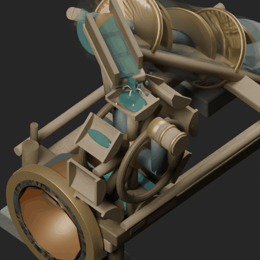

# Beach pump V8 — resumed native animation review

Continues the unpublished V7 work recovered from the interrupted “Refine Beach Pump Model” session. This is a visual-review checkpoint, not an accepted production asset.




## Recovered and continued

V7 replaced the eight open/intersecting paddles with solid curved bucket shells and closed wooden ends, moved the wheel rings outside the bucket cavities, and added a trough-to-wheel water sheet with impact spray. Its earlier clearance check sampled every sixth frame.

V8 checks every native frame and fixes an intermediate-phase gutter collision missed by V7. The wheel and its supports are lowered by another 0.025 Blender units; the drive shaft is realigned. Bucket water fills and empties with wheel rotation, and eight timed runoff curves follow the actual moving bucket lips instead of hanging at fixed points. Runoff ends at the catch-pan water level. Trough bead-like glints are removed. Wood receives directional grain, color variation and dry/wet roughness contrast. The impact crown changes thickness as buckets pass.

## Evidence

The editable `.blend` independently reopens in Blender 5.0.1. All 97 native loop phases were checked: zero bucket/ring or bucket/gutter surface intersections, zero stationary pipe-port vertex drift. The new drain animation closes within 0.000001 Blender units; new effects are hidden at idle frame zero. The 45-degree orthographic review camera is retained.

The close-up preview contains 32 separately rendered phases over the 96-frame cycle, alongside full-object and close-up still renders. All preview pixels come from Blender Cycles. Water is authored mesh/curve animation, not a fluid dynamics simulation.

## Remaining review

The bucket water still has a simplified meniscus and drainage profile; it is not a physical fill simulation. Material and splash readability at small sprite sizes need visual acceptance. No game integration or production atlas capture has been performed. Human visual approval remains false.

## Reproduce

From the repository root:

```sh
blender -b models/island-survival/beach-pump/generated-v6-review/beach-pump-v6-review.blend --python models/island-survival/beach-pump/v7/refine_buckets.py -- --out /absolute/v7
blender -b /absolute/v7/beach-pump-v7-review.blend --python models/island-survival/beach-pump/v8/refine_native.py -- /absolute/v8
blender -b /absolute/v8/beach-pump-v8-review.blend --python models/island-survival/beach-pump/v8/verify_native.py -- /absolute/v8
```

The exact recovered V7 native file is also committed under `generated-v7-review` so the continuation can be reproduced from that checkpoint directly.
