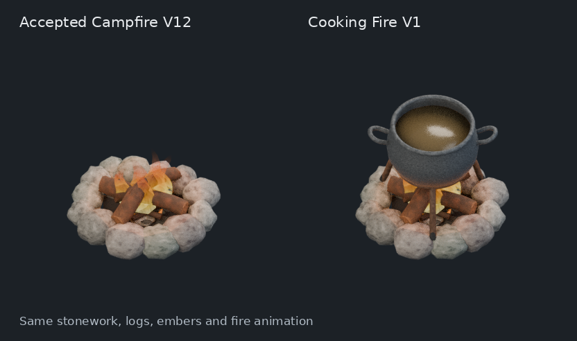
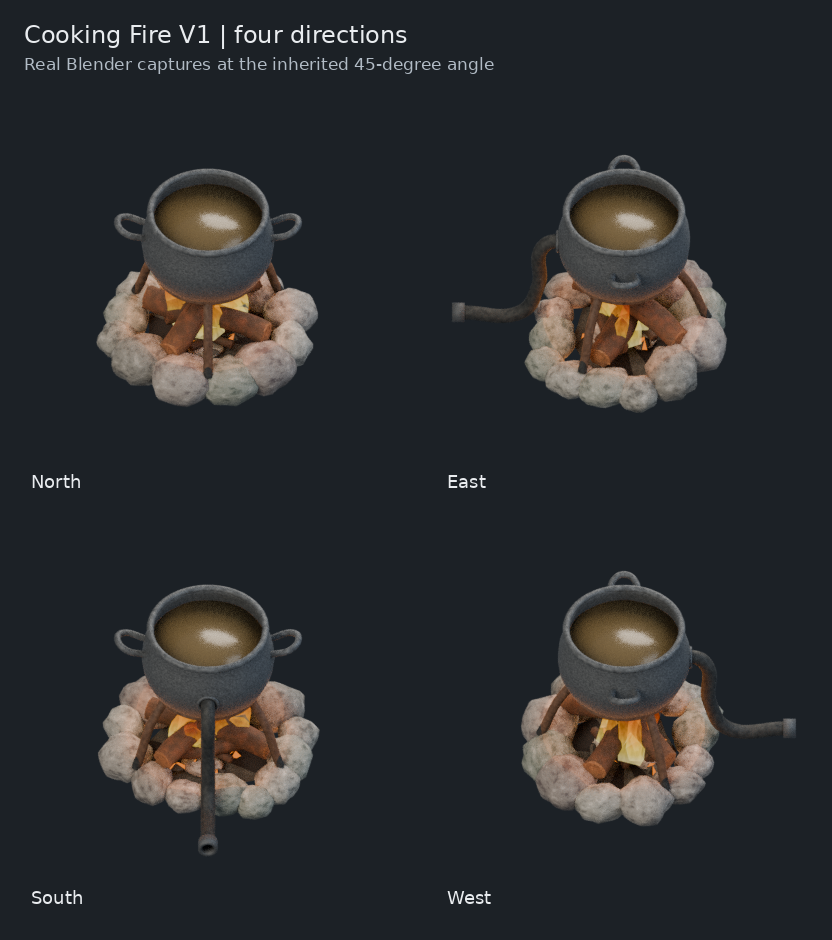
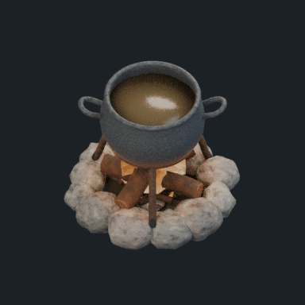

# Cooking Fire V1 — built on the accepted campfire

The owner requested that the existing campfire be the basis of the Cooking Fire.
This is the first editable Blender candidate: a thick iron cauldron, two side
handles, a three-legged trivet and a rear steam fitting are added to the exact
accepted V12 campfire. The original 72 meshes, their materials and transforms,
the packed textures, and the existing fire animation are preserved.

## Review







The images are actual Blender renders, not image-generation concepts. The
native file is `cooking-fire-v1.blend`. This candidate has not been installed
as the in-game Cooking Fire, and does not mark the model visually accepted.

## Source and construction

- Accepted source: `models/island-survival/blender/production-v12-structure-45/master.blend`.
- Read at commit `ce3ef9720298807e3036962bde094341643c237f`.
- Source SHA-256: `7cf8e35b27a670f00bc5b4a5b55c2dbe4ce448edb3ad8bf1b3ff9fd316493632`.
- Source acceptance record: `docs/art/CAMPFIRE_ACCEPTED_21.md`.
- Construction/review: Blender 4.3.2, Cycles CPU, 32 samples, transparent 384px captures.
- Source stones, logs, coals and flame meshes remain at their original coordinates.
  This also preserves the source's position-dependent wood scorch materials.
- New objects are in `05 | Cooking Fire additions`, below the existing direction
  pivot. The three feet are placed against ray-cast source stone surfaces.
- The source camera's 45-degree elevation and stationary daylight are retained.
  Framing expands to a 3.35-unit orthographic canvas, aimed at `(0,0,0.70)`.
- Frame 0 is cold. Frames 1–96 retain the source fire animation. The preview
  samples frames 1,7,...,91 at 8 fps, matching the accepted campfire sampling.

## Steam connection

The existing Cooking Fire gameplay prototype remains a 3x3 assembling machine
with ordinary/advanced cooking and a north-facing input at pipe cell `(0,-1)`.
The added model fitting ends at Blender `(0,1.5,0.35)`, using +Y as north and a
provisional one-unit-per-tile convention. `SOCKET | steam input | north boundary`
records this distinction between pipe-cell center and tile-edge connection plane.
Actual sprite-to-pipe visual registration is a later integration step; it has
not been inferred from this model-only review.

## Reproduce

From this directory, with the repository's accepted source present:

```sh
blender -b -t 4 --python-exit-code 1 --python build_cooking_fire_v1.py -- \
  --source-blend ../../blender/production-v12-structure-45/master.blend \
  --output-dir output --render proof
python3 package_review.py
```

`--render none` builds, saves and independently reopens the native candidate.
`--render pilot` adds one working north render. `--render proof` produces cold
and working views from all four directions, a matched source comparison and
the 16-frame working loop. No Actions runner is dispatched by these scripts.

## Verified scope

`build-report.json` records the exact source/native hashes, original-mesh
fingerprints, support contacts and actual captured frames. The 72 source-mesh
fingerprints match after native save/reopen; original animation actions remain.
Every captured PNG fully decodes, has transparent margins and retains the fixed
camera. The GIF contains 16 frames. These are model/render checks, not Factorio
runtime or final atlas-integration claims.
