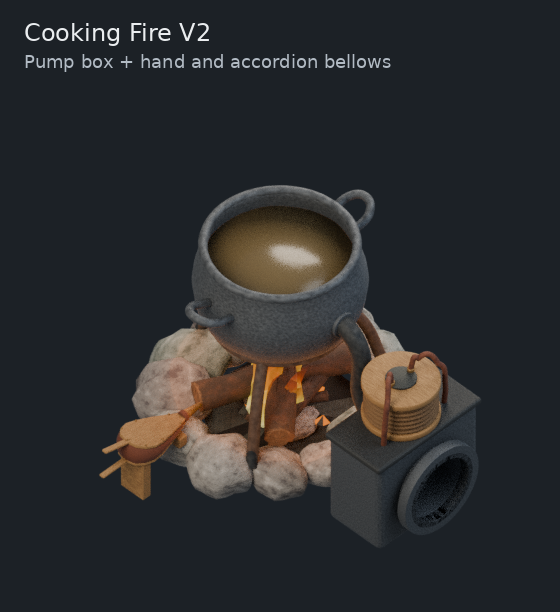
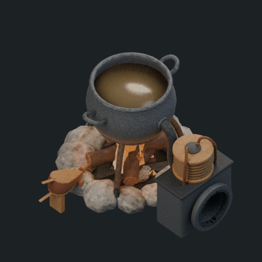
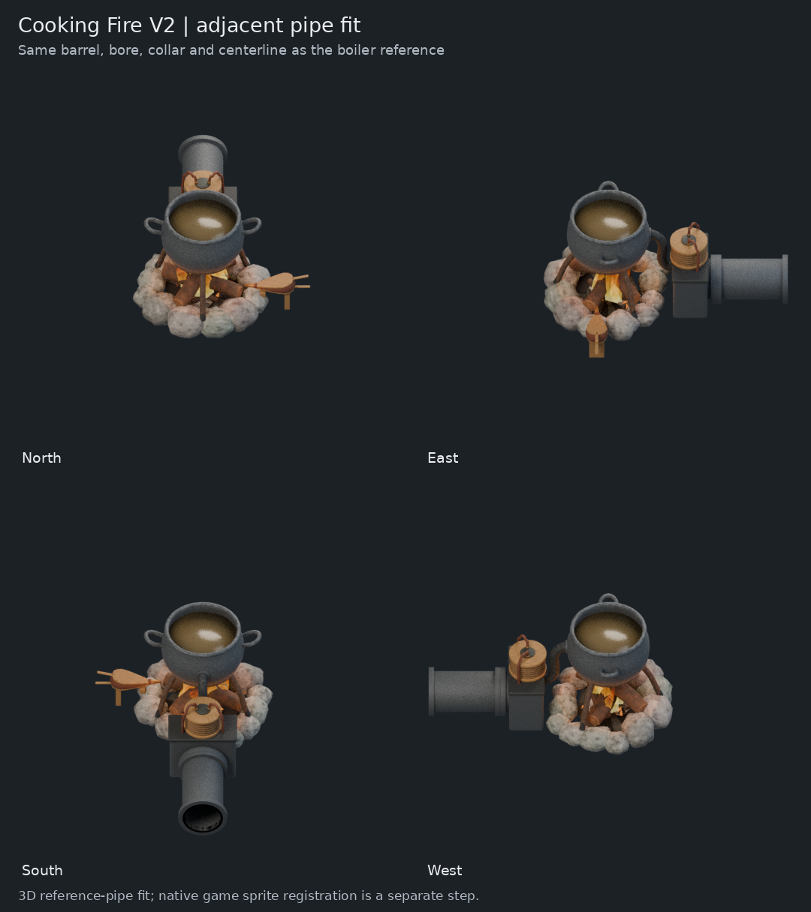
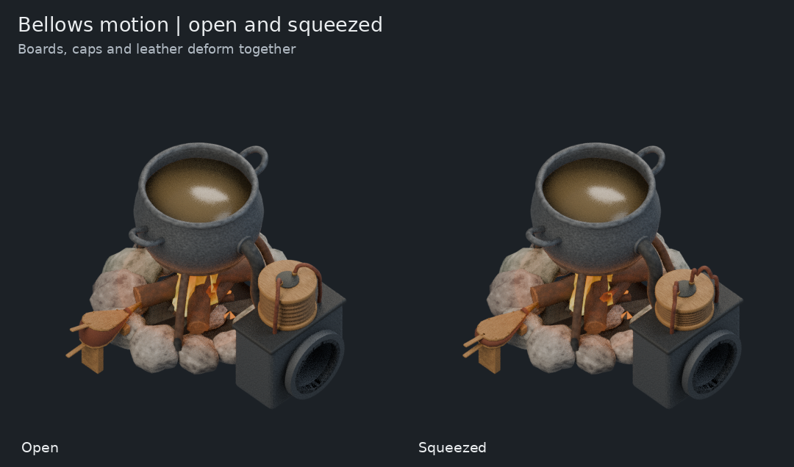

# Cooking Fire V2 — pump box and both bellows references

The owner requested a proper pump box and a fluid mount sized to meet an
adjacent Factorio pipe, following the boiler's existing interface. Both supplied
bellows references are incorporated as visible, editable 3D geometry.





## Changes

- Replaced V1's undersized free pipe with a cast pump housing and a full-size,
  open flanged mount. The smaller feed to the cauldron now leaves this housing.
- Added a traditional teardrop hand bellows: two wooden boards and handles,
  brown leather pouch, perimeter studs and hollow tapered nozzle aimed at the
  fire. Its stationary lower board rests on two fitted timber supports.
- Added a six-fold accordion squeeze bellows on the pump box, with wood caps,
  leather folds and two flexible top lines. The modern plastic appearance of
  the reference is adapted to the station's primitive materials.
- Both controls compress smoothly over the inherited 96-frame working cycle.
  Boards/caps, leather and flexible lines move together. Frame 0 is the open
  resting pose. A mixed integer/float property issue found during the pilot was
  corrected before capture; frames 25 and 73 now evaluate to 0.5 compression.
- Preserved 81 existing V1 mesh/curve objects, including the accepted campfire,
  cauldron, handles, cooking surface and trivet. Their fingerprints match after
  native save/reopen. Original fire animation actions and materials remain.

## Pipe dimensions and actual model fit

These dimensions reuse the documented boiler/condenser standard at one Blender
unit per tile, rather than estimating a new pipe size:

| Measurement | Tiles |
|---|---:|
| Barrel outside diameter | 0.57 |
| Bore inside diameter | 0.49 |
| Mounting collar outside diameter | 0.68 |
| Collar axial thickness | 0.075 |
| Centerline above ground | 0.36 |
| Adjacent pipe length | 1.0 |

Source authority: [Boiler V05 construction](https://github.com/mrcalzon02/Tech-Priests/blob/0ea7ed22d508fb2f5c7d71102679b0be80a379ab/art/source-to-3d/boiler-v05/build_boiler_v05.py),
[dimensional record](https://github.com/mrcalzon02/Tech-Priests/blob/0ea7ed22d508fb2f5c7d71102679b0be80a379ab/art/source-to-3d/boiler-v05/README.md), and the
[boiler's native visual registration](https://github.com/mrcalzon02/Tech-Priests/blob/0ea7ed22d508fb2f5c7d71102679b0be80a379ab/docs/art/boiler-v08-visual-alignment/visual-registration-validation.json).

The existing Cooking Fire is 3x3, with native north pipe cell `(0,-1)` and
adjacent pipe center `(0,-2)`. With Blender +Y as north, its joint plane is
`(0,1.5,0.36)`. The machine collar ends at Y1.5; the adjacent barrel begins
there and continues to Y2.5. All 128 corresponding annular face vertices match
within `0.000001` tile (actual residual in `build-report.json`).



The exact one-tile reference barrel and collars are retained in a separate
`REFERENCE ONLY | adjacent standard pipe` collection. They are hidden from
asset renders and must be excluded from production sprites.

**Direction mapping:** N0°, E−90°, S180°, W90°. This corrects the V1 review's
East/West labeling for the declared +Y=north model convention.

This establishes **3D model-to-reference-pipe fit**. Cooking Fire native sprite
registration is not yet performed. The boiler's per-direction draw shifts must
not be copied: they fit the boiler's own camera and two-mouth landmarks. No
gameplay prototype, collision, recipe or workflow was changed by this model step.

## Reproduce

Source is the committed V1 `cooking-fire-v1.blend`, SHA-256
`edf8e055e4f1e8ee1a94e7a7bc0028ef51aab9b7c83fae22a382a59a579957b8`,
from commit `d9e12ce02fa55c5239be12b5f38e6ac14b87dddc`.

From this directory:

```sh
blender -b -t 4 --python-exit-code 1 --python build_cooking_fire_v2.py -- \
  --source-blend ../v1/cooking-fire-v1.blend --output-dir output --render proof
python3 package_review.py
```

Keep `bellows_components.py` alongside the generator. `--render none` builds,
verifies interfaces and reopens the native file; `pilot` adds the hero view;
`proof` produces cardinal idle/working views, the pipe-fit jig, open/compressed
poses and the inherited 16-frame capture schedule at 8fps. Actual Blender 4.3.2
Cycles renders use the fixed 45-degree camera and original daylight.



## Reference provenance

The user's supplied reference images are used as shape references only; their
pixels are not part of the model textures or this repository addition.

- Wooden hand bellows: `image(3).png`, SHA-256
  `07d6aaacce2f2c471a46cd4e860d511b07800da98074bd718dfcd1d866f062f2`.
- Accordion squeeze bellows: `image(4).png`, SHA-256
  `abfc4975c6a0d81f40186888e1698185adf2502160f9dafd26b7b33f0f1d85bd`.

The source V1 model itself derives from the accepted Campfire V12; its previous
source receipt remains in `../v1`. This is an editable V2 model candidate,
not a claim of final appearance acceptance or native game integration.
