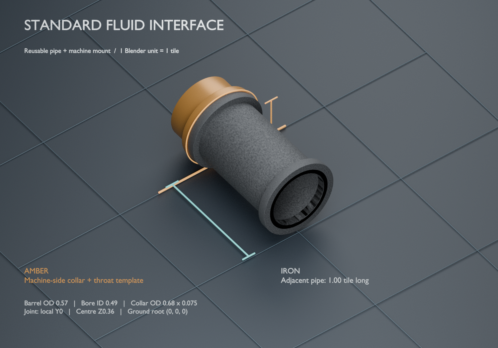

# Reusable Factorio fluid interface

A standalone Blender modeling environment for fitting pipes to future machines.
The five interface meshes are extracted from the verified Cooking Fire V2 joint,
with its joint moved to a reusable local origin. The source machine is not
included. Amber material identifies the machine-side templates; finish is not
part of the dimensional standard.



## Use it on the next machine

1. Open the machine's actual `.blend` source.
2. **File → Append → `factorio-fluid-interface-reference.blend` → Collection →
   `FACTORIO_FLUID_INTERFACE_REFERENCE`.**
3. Select **`IFACE | ground placement root`** and put it at the ground projection
   of the declared joint boundary. Keep its scale **1, 1, 1**. The socket is
   already 0.36 units above this root.
4. Rotate the root around Z: **north 0°, east −90°, south 180°, west 90°**.
   Local +Y points from the machine into the adjoining pipe.
5. Shape the receiving box, manifold or neck around the amber collar/throat.
   Duplicate the needed machine-side template into the machine's own collection
   and preserve its world transform. Give that authored part the machine's
   intended material.
6. Keep the reference assembly for comparisons. Exclude it and all review helpers
   from final machine sprite renders; the machine's authored fitting remains.

The file also contains a separate **`REVIEW ENVIRONMENT | do not append`**
collection with a one-tile ground grid, joint outline, dimension guides, labels,
lights and a fixed 45° orthographic camera. Open the native file to inspect that
environment. Appending only the fixture does not import the environment.

See the [full modeling guideline](../../../docs/art/FLUID_CONNECTION_MODELING_GUIDE.md)
for footprint placement, coordinate conversion and production handoff. A
`START HERE | fluid interface reference` text block is embedded in the native
file so the placement contract travels with it.

## Fixed contract

**One Blender unit equals one Factorio tile.**

| Element | Dimension or location |
|---|---|
| Barrel outside diameter | 0.57 |
| Open bore inside diameter | 0.49 |
| Collar outside diameter / axial thickness | 0.68 / 0.075 |
| Socket centre above ground | 0.36 |
| Adjacent barrel length | 1.0 |
| Ground root / socket centre | `(0, 0, 0)` / `(0, 0, 0.36)` |
| Mating plane / outward axis | Y0 / +Y |
| Machine collar / throat span | Y−0.075…0 / Y−0.29…0 |
| Reference pipe span | Y0…1 |

The collection is marked as a Blender asset. Its stable identity is
`factorio-fluid-interface-v1`; object custom properties named `interface_role`
identify parts even after Blender adds suffixes to repeated append operations.

| Object role | Purpose |
|---|---|
| `placement_root` | Move/rotate the entire assembly from the ground joint |
| `socket_marker` | Joint centre and outward direction |
| `machine_cell_marker` | Ground pipe-cell centre, half a tile inward |
| `adjacent_cell_marker` | Ground pipe-cell centre, half a tile outward |
| `reference_barrel` | One-tile adjacent pipe barrel |
| `reference_near_collar`, `reference_far_collar` | Adjacent pipe end collars |
| `machine_collar`, `machine_throat` | Templates for the authored machine fitting |

## Optional Python helper

`append_reference.py` exposes `append_interface(...)` for Blender Python:

```python
from append_reference import append_interface

fixture, root = append_interface(
    "/absolute/path/to/factorio-fluid-interface-reference.blend",
    joint_ground=(0, 1.5, 0),
    facing="N",
    name="Cooking Fire north inlet",
)
```

The returned collection is editable and locally appended. Each call creates an
independent placement root, preserving the active machine and its existing
objects. Import the module from this folder or add the folder to `sys.path`.

The CLI can save an appended copy without overwriting an existing output:

```bash
blender --background machine.blend \
  --python models/reference/factorio-fluid-interface/append_reference.py -- \
  --reference models/reference/factorio-fluid-interface/factorio-fluid-interface-reference.blend \
  --output machine-with-pipe-reference.blend --joint 0 1.5 0 --facing N
```

## Rebuild and verify

From the repository root, using Blender 4.3.2 or a compatible version:

```bash
blender --background \
  --python models/reference/factorio-fluid-interface/build_reference.py -- \
  --source models/island-survival/cooking-fire/v2/cooking-fire-v2.blend \
  --output models/reference/factorio-fluid-interface

blender --background \
  --python models/reference/factorio-fluid-interface/verify_reference.py -- \
  --reference models/reference/factorio-fluid-interface/factorio-fluid-interface-reference.blend \
  --output models/reference/factorio-fluid-interface/append-verification.json
```

The builder checks the pinned source hash, extracts the original five meshes
without changing their dimensions or topology, preserves their bevels, and
records hashes and bounds in [reference-manifest.json](reference-manifest.json).
It saves and reopens the native file before checking the 128 mating-face
vertices, bore and collar sizes, unit scale and independent dependencies.

The separate [append verification](append-verification.json) exercises repeated
appending into a fresh scene, cardinal directions and different machine
footprints. It records the exact native hash tested. These are focused checks of
the reusable reference; they do not install any game graphics or alter CI.

**Native sprite registration belongs to the machine being integrated.** Use this
asset to establish the 3D interface, then verify that machine's projected mouth,
scale and shift against an actual connected pipe in Factorio. Boiler draw offsets
are not a general preset.

## Provenance

- Extracted from [Cooking Fire V2, commit `807d024`](https://github.com/mrcalzon02/Tanks-for-bob-Fork/tree/807d024e74507d60fbdc04d17cd4738a02eaf225/models/island-survival/cooking-fire/v2).
- Dimensions originate in the [Boiler V05 reference constructor](https://github.com/mrcalzon02/Tech-Priests/blob/0ea7ed22d508fb2f5c7d71102679b0be80a379ab/art/source-to-3d/boiler-v05/build_boiler_v05.py).
- Revision-specific source and native SHA-256 hashes are recorded in the manifest.
